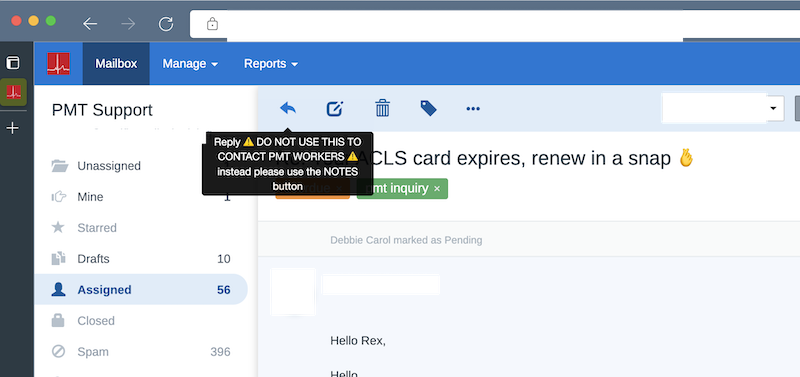

# FreeScout Dropkick JS

[](https://github.com/fulldecent/freescout-dropkick-js/actions/workflows/build-test.yml)

Dropkick JS adds a JavaScript snippet at the bottom of every page load.

We used it specifically to add a warning before somebody attempts to use the REPLY button if they were trying to contact one of our other support agents.

In this picture, a popup is added over the reply button that you can't miss.



## Use cases

- Add warnings/notices to parts of the UI that are specific to your company
- Prototype new features to add into FreeScout
- Quick productivity hacks

## Installation

These instructions assume you installed FreeScout using the [recommended process](https://github.com/freescout-helpdesk/freescout/wiki/Installation-Guide), the "one-click install" or the "interactive installation bash-script", and you are viewing this page using a macOS or Ubuntu system.

Other installations are possible, but not supported here.

1. Download `DropkickJS.zip` from the [latest release of FreeScout Dropkick JS](https://github.com/fulldecent/freescout-dropkick-js/releases/latest).

2. Unzip the file locally. It contains a folder named `DropkickJS`.

3. Open `DropkickJS/Providers/DropkickJSServiceProvider.php` using a code editor and change between the `<<<JS` and `JS` lines to remove my hack use case and add your own.

4. Copy the folder into your server using SFTP.

   ```sh
   scp -r ~/Downloads/DropkickJS root@freescout.example.com:/var/www/html/Modules/
   ```

5. SSH into the server and update permissions on that folder.

   ```sh
   chown -R www-data:www-data /var/www/html/Modules/DropkickJS/
   ```

6. Access your admin modules page like https://freescout.example.com/modules/list.

7. Find **Dropkick JS** and click ACTIVATE.

8. Purchase a license code by sending USD 10 at https://www.paypal.com/paypalme/fulldecent/10usd

## Updating

The module updates itself from your FreeScout modules page (requires FreeScout 1.8.124 or later). FreeScout checks `version.txt` of the latest GitHub release and installs its `DropkickJS.zip`.

Installations from before these update URLs were added still have no `latestVersionUrl`. Update those once by hand with `DropkickJS.zip` from the latest release (steps 1-5 above, replacing `Modules/DropkickJS/`).

## Releases

Use `fix:`, `feat:`, or `BREAKING CHANGE:` in your commit messages. This triggers our bot to make a release draft pull request. Merging that pull request triggers a new tag and GitHub Release.

The [release workflow](.github/workflows/release.yml) uses Release Please's `simple` release type through [release-please-config.json](release-please-config.json). That file exists so the release pull request bumps `version` in [module.json](module.json) as well as [version.txt](version.txt). Do not add a `version` field to [composer.json](composer.json). The tag is the version, with a leading `v`. `version.txt` and `module.json` use the same number without the `v`, because FreeScout compares those two strings.

A commit on `main` whose message starts with `fix:` opens or updates a release pull request that bumps the patch version. `feat:` bumps the minor version. `BREAKING CHANGE:` bumps the major version. One release pull request collects every such commit since the last `v` tag. A commit with any other prefix, including `chore:` and `docs:`, does not open that pull request. Merging the release pull request is the release. Release Please writes [CHANGELOG.md](CHANGELOG.md) in that pull request and does not create the tag. The publish job creates the tag.

[Build and test](.github/workflows/build-test.yml) checks PHP syntax on PHP 8.4 and PHP 8.5, packs `DropkickJS.zip` and `version.txt`, then attests and uploads them. The release includes those two files and `release.sigstore.jsonl`. The zip filename has no version in it. The version is the tag, and the attestation records that version without a leading `v`.

FreeScout downloads `DropkickJS.zip` and `version.txt` from the latest GitHub release. The zip's root folder is `DropkickJS/`. This is not a Packagist package.

The original release tag is `1.0.0`, with no `v` prefix. `v1.0.0` points at the same commit as `1.0.0`, which is the version Release Please counts forward from.

> [!NOTE]
> In your GitHub repository settings, under Actions, General, Workflow permissions, select read and write permissions and check "Allow GitHub Actions to create and approve pull requests". Under General, Releases, enable release immutability. Attestations are available for public repositories; private repositories require GitHub Enterprise Cloud.

## Project scope

Our goal is to have a very simple module to allow vast extensibility in FreeScout.

Anything that makes it simpler (removes unneded code) or more extensible for most people will be a welcome improvement.

At this point, it is a non-goal to add friendly configuration of `<<<JS` or other configuration options.

## Troubleshooting

If something is not working, please try these steps so we can see what's wrong.

1. Update FreeScout to the latest version (even if the new version doesn't have any relevant changes, the process of updating can sometimes fix problems that would prevent freescout-sidebar-webhook from running).
2. Use `chown -r` to ensure the module has the same owner/permissions as other files in your FreeScout installation.
3. Try to disable and reenable freescout-sidebare-webhook from your system/modules page.
4. To confirm the module file is actually activated and readable you might add a line like this above the `private const MODULE_NAME` line. The code to add is: `file_put_contents("/tmp/sidebartmp", "is running");` And then you can confirm it is running by seeing if that file is created when you load the page.
5. Next check for system logs. It will be helpful to note any warnings, errors or notices as they may instruct where the problem is coming from.
6. Check your PHP version, is it a version supported by FreeScout?

After you have checked all these things, please create an issue and detail how you tried each of these steps.

## Inspiration

* This project was inspired by [Sidebar API](https://scoutdevs.com/downloads/sidebar-api/).
